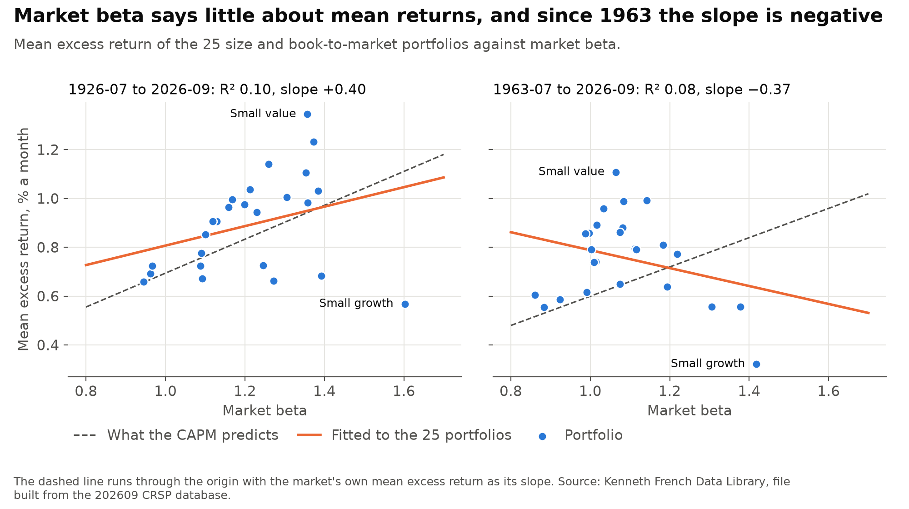
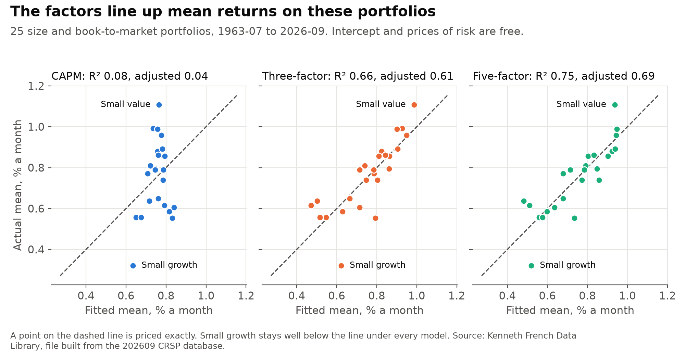
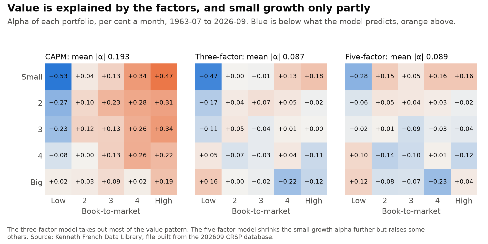
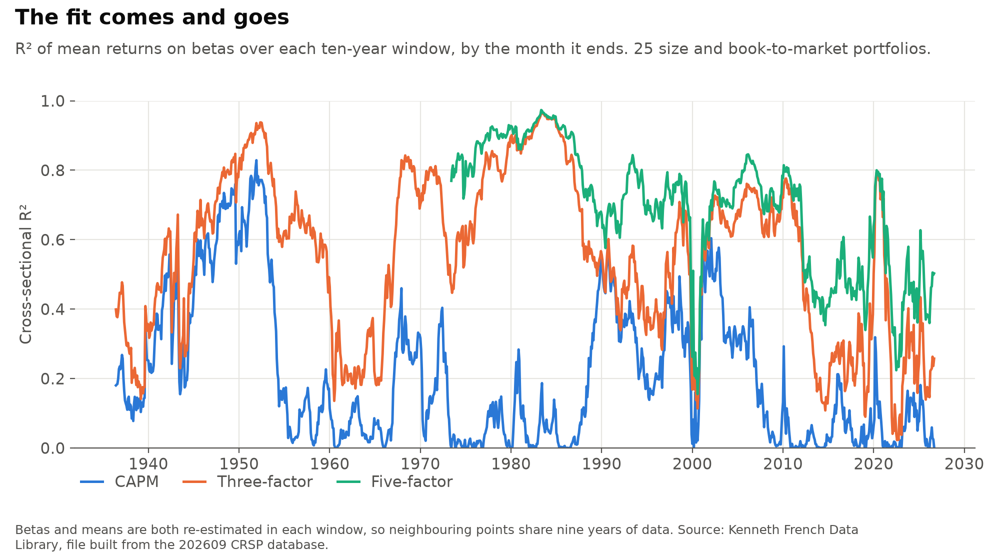
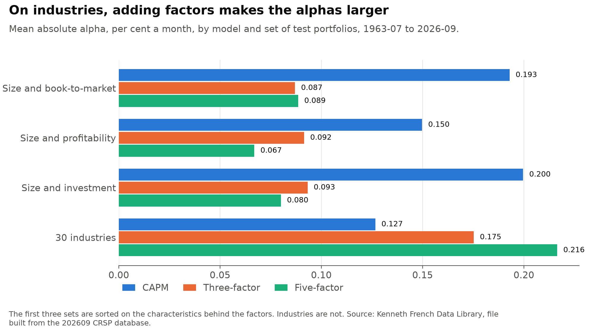

# capm_factor_tests

[](https://github.com/atamalfuzi/capm_factor_tests/actions/workflows/tests.yml)

Why do some stocks earn more than others on average? The textbook answer is the capital asset pricing model (CAPM): a stock's expected return depends only on its market beta, which measures how strongly it moves with the market as a whole. This project tests that answer on US stock returns from 1926 to September 2026. It also asks how much two well-known extensions add: the Fama-French three-factor model, which adds company size and value, and the five-factor model, which also adds profitability and investment. Python, with pandas and SciPy.

Results are as of November 2026, with data through September 2026 from the Kenneth French Data Library, in files built from the 202609 CRSP database.

> **Personal project.** This is my own analysis of publicly available data. It is not associated with my work for any current or past employer and does not represent their views.

| Question | Methods | Answer |
|---|---|---|
| [Does my 2021 result still reproduce?](#1-does-the-2021-result-reproduce) | The same regression on the same files | Yes: an R² of 0.1144 and a slope of 0.3993. With today's files and data through 2026-09, the R² is 0.098. |
| [Does the CAPM hold up?](#2-does-the-capm-hold-up) | GRS test, Fama-MacBeth regressions | No. The test rejects it (p below 0.001), and since 1963 portfolios with higher betas have earned no more on average. |
| [How much do the extra factors add?](#3-how-much-do-the-extra-factors-add) | The same tests, Hansen-Jagannathan distance, tests between factors | A lot on the usual test portfolios. The share of differences in average returns explained rises from 8% to 66% with three factors and 75% with five. All three models are still rejected. |
| [Is it stable over time?](#4-is-it-stable-over-time) | Four periods, ten-year windows | No. The CAPM passes before 1963. Since 2009, no model explains more than 16%. |
| [Does it depend on which portfolios are tested?](#5-does-it-depend-on-which-portfolios-are-tested) | Three more sets of portfolios | Yes. On 30 industry portfolios the CAPM isn't rejected, though beta explains little of their average returns, and the extra factors make the errors larger. |

## How the tests work

The tests use portfolios, groups of stocks sorted by some feature, because single stocks are too noisy. The main set is 25 portfolios formed by sorting US stocks on size (market value) and on book-to-market, the ratio of a company's accounting value to its market value. Stocks with a high book-to-market ratio are called value stocks, and those with a low one growth stocks. Returns are monthly, in per cent, and measured above the one-month Treasury bill rate.

Each model names one or more factors. A factor is the return on a particular portfolio:

| Factor | What it is |
|---|---|
| Market (Mkt-RF) | The whole US stock market, less the T-bill rate |
| SMB, small minus big | Small companies less large ones |
| HML, high minus low | Value stocks less growth stocks |
| RMW, robust minus weak | Highly profitable companies less weakly profitable ones |
| CMA, conservative minus aggressive | Companies that invest little less those that invest a lot |

The CAPM uses the market alone. The three-factor model adds SMB and HML, and the five-factor model adds RMW and CMA.

- **Beta and alpha.** Each portfolio's monthly return is regressed on the factors. The slopes are its betas, how strongly it moves with each factor. The intercept is its alpha, the average return the model leaves unexplained. If a model is right, every alpha is zero.
- **GRS test** (Gibbons, Ross and Shanken, 1989). It asks whether all 25 alphas are zero together. A small p-value means the model is rejected. The test assumes returns are normally distributed, which they are not quite, so I also report a p-value from resampling the data that does not rely on that assumption.
- **Fama-MacBeth regressions** (Fama and MacBeth, 1973). They ask the question the other way round: do portfolios with higher betas earn higher average returns, and how much more per unit of beta? That amount is the factor's price. If the model is right, the line through the portfolios passes through zero and each factor's price equals its average return. Shanken's (1992) correction allows for the betas being estimates. The R² of this line is the share of the differences in average returns across portfolios that the betas explain. The 2021 result of 11% is this R².
- **Hansen-Jagannathan distance** (Hansen and Jagannathan, 1997). It is the largest pricing error a model makes on any combination of the test portfolios, with each combination scaled to the same size. Zero is a perfect fit.

The five-factor data start in July 1963, so comparisons of all three models use July 1963 to September 2026, 759 months.

## 1. Does the 2021 result reproduce?

In 2021 I ran this CAPM regression on the 25 portfolios and found that betas explain 11.4% of the differences in average returns.

| Sample | Months | R² | Slope | Average market excess return, % a month |
|---|---:|---:|---:|---:|
| 2021 files, 1926-07 to 2020-09 | 1131 | 0.1144 | 0.399 | 0.670 |
| 2021 files, stopped at 2019-12 | 1122 | 0.1035 | 0.402 | 0.667 |
| Current files, 1926-07 to 2020-09 | 1131 | 0.1176 | 0.413 | 0.671 |
| Current files, 1926-07 to 2026-09 | 1203 | 0.0978 | 0.399 | 0.694 |
| Current files, 1963-07 to 2026-09 | 759 | 0.0822 | −0.367 | 0.600 |

The first row matches the 2021 result exactly, and a test checks it. Those files ran to September 2020, so stopping at the end of 2019 gives a different figure.

The 2021 run used total returns, where returns above the T-bill rate are usual. That changes only the intercept. The R² and the slope stay the same, because the T-bill rate shifts every beta by the same amount. Its Sharpe ratio, the average excess return divided by its standard deviation, used the standard deviation of the total market return instead. That gives 0.1255 against 0.1253.

French's files change over time as CRSP, the database behind them, corrects its records. Over the same months, portfolio returns moved by 0.20 percentage points a month on average, and by up to 9.4 points in one month (small growth stocks, January 1945). No portfolio's average moved by more than 0.016. That is why the same months now give 0.1176.

## 2. Does the CAPM hold up?



| Sample | GRS F | p-value | p-value, resampled | Average absolute alpha, % a month | R² | Intercept (t) | Price of market risk (t) | Average market excess return |
|---|---:|---:|---:|---:|---:|---:|---:|---:|
| 1926-07 to 2026-09 | 3.39 | 5×10⁻⁸ | below 0.001 | 0.154 | 0.098 | 0.41 (1.27) | 0.40 (1.15) | 0.69 |
| 1963-07 to 2026-09 | 4.17 | 1×10⁻¹⁰ | below 0.001 | 0.193 | 0.082 | 1.16 (3.12) | −0.37 (−0.92) | 0.60 |

The t-values in brackets use Shanken's correction. Values beyond about ±2 are significant at the 5% level.

Betas explain a similar small share in both samples, 10% and 8%, but the two samples say different things. Over the full history, higher beta goes with higher average returns, at about 60% of the rate the CAPM predicts. Since 1963 the slope is negative, so higher-beta portfolios earned slightly less. Neither slope is clearly different from zero (t = 1.15 and −0.92). The intercept, which the CAPM says should be zero, is 1.16% a month. The R² alone hides this.

The R² from one sample is a rough measure. Resampling the months gives a 95% range of 0.00 to 0.53 for the R² since 1963.

## 3. How much do the extra factors add?



| 1963-07 to 2026-09 | CAPM | Three-factor | Five-factor |
|---|---:|---:|---:|
| GRS F | 4.17 | 3.63 | 3.21 |
| p-value | 1×10⁻¹⁰ | 9×10⁻⁹ | 3×10⁻⁷ |
| p-value, resampled | below 0.001 | below 0.001 | below 0.001 |
| Average absolute alpha, % a month | 0.193 | 0.087 | 0.089 |
| Largest absolute alpha | 0.529 | 0.466 | 0.277 |
| R² | 0.08 | 0.66 | 0.75 |
| R², adjusted for the number of factors | 0.04 | 0.61 | 0.69 |
| 95% range for R² | 0.00 to 0.53 | 0.22 to 0.85 | 0.39 to 0.90 |
| R² with no intercept and each price equal to the factor's average | −0.85 | 0.42 | 0.59 |
| Hansen-Jagannathan distance | 0.375 | 0.351 | 0.328 |
| 95% range | 0.339 to 0.513 | 0.316 to 0.480 | 0.278 to 0.451 |

On these portfolios the three-factor model does most of the work. It halves the average alpha and removes most of the difference between value and growth stocks. The five-factor model leaves the average alpha about where it was, and mainly shrinks the largest one, for small growth stocks, from −0.47 to −0.28% a month. The R² ranges overlap, so the data cannot tell the two models apart on that measure. All three models are rejected.



The row with no intercept and each price equal to the factor's average is the stricter measure, because that is what the models actually claim. It can be negative. For the CAPM it is −0.85, which means the model's line fits worse than a flat line at the average return.

When the line is not held to the model's claims, the estimated prices can look odd. In the five-factor fit the market's price is −0.49 (t −1.52), with an intercept of 1.05. Market betas are all close to 1 across these portfolios, so the data cannot separate the market's price from the intercept. Their sum, 0.56, is close to the market's average of 0.60. Shanken's correction changes little here. For example, it moves that t-value from −1.58 to −1.52, because monthly factor returns are small relative to their swings.

The Hansen-Jagannathan distance is measured on the 25 portfolios plus the T-bill. A model with no factors, which discounts every return at the same rate, gives 0.400 (range 0.368 to 0.534). The CAPM, three- and five-factor models reduce that by 6%, 12% and 18%. Adding a factor can only reduce the distance, and the ranges overlap.

Another way to ask whether a factor adds anything is to test whether it earns returns the other factors cannot explain, that is, whether it has an alpha against them. These use the five-factor file, July 1963 to September 2026:

| Added | Against | Alpha, % a month | p-value |
|---|---|---:|---:|
| SMB and HML | Market | 0.070 and 0.376 | 0.002 |
| RMW and CMA | Market, SMB, HML | 0.298 and 0.179 | 5×10⁻⁷ |
| HML | The other four | −0.025 | 0.75 |
| SMB | The other four | 0.181 | 0.08 |
| RMW | The other four | 0.335 | 3×10⁻⁵ |
| CMA | The other four | 0.207 | 1×10⁻⁴ |

HML, the value factor, has no alpha once the other four are included. Fama and French (2015) found this, and it still holds through 2026. Profitability and investment add the most. Combining each model's factors, the best Sharpe ratio available rises from 0.47 a year for the market alone to 0.65 with three factors and 0.95 with five.

## 4. Is it stable over time?

| Period | Model | GRS F | p-value | p-value, resampled | Average absolute alpha | R² |
|---|---|---:|---:|---:|---:|---:|
| 1926-07 to 1963-06 | CAPM | 1.38 | 0.106 | 0.185 | 0.146 | 0.30 |
| | Three-factor | 1.65 | 0.027 | 0.092 | 0.147 | 0.63 |
| 1963-07 to 1990-12 | CAPM | 1.89 | 0.007 | 0.037 | 0.264 | 0.06 |
| | Three-factor | 1.31 | 0.154 | 0.203 | 0.089 | 0.77 |
| | Five-factor | 0.93 | 0.559 | 0.540 | 0.080 | 0.87 |
| 1991-01 to 2008-12 | CAPM | 4.20 | 5×10⁻⁹ | 0.008 | 0.334 | 0.34 |
| | Three-factor | 3.75 | 9×10⁻⁸ | 0.009 | 0.150 | 0.71 |
| | Five-factor | 3.47 | 6×10⁻⁷ | 0.075 | 0.188 | 0.71 |
| 2009-01 to 2026-09 | CAPM | 1.82 | 0.013 | 0.079 | 0.229 | 0.00 |
| | Three-factor | 1.71 | 0.024 | 0.119 | 0.090 | 0.14 |
| | Five-factor | 1.68 | 0.029 | 0.119 | 0.097 | 0.16 |
| 2020-10 to 2026-09 | CAPM | 1.73 | 0.053 | n/a | 0.414 | 0.07 |
| | Three-factor | 1.48 | 0.124 | n/a | 0.261 | 0.54 |
| | Five-factor | 1.64 | 0.076 | n/a | 0.258 | 0.64 |

The last three rows cover the months since the 2021 files ended, and they overlap the three rows above them.

Before 1963 the CAPM is not rejected, and higher betas go with higher average returns, though the price of market risk is imprecise (0.67, t 1.22). The three- and five-factor models fit best from 1963 to 1990, close to the period they were designed on. Since 2009 their R² has fallen to 0.14 and 0.16, and whether they are rejected depends on which p-value you use. The 72 months since October 2020 are too few to settle much with 25 portfolios.



## 5. Does it depend on which portfolios are tested?



| 1963-07 to 2026-09 | Model | GRS F | p-value, resampled | R² | R², adjusted | R² with prices at factor averages |
|---|---|---:|---:|---:|---:|---:|
| Size and profitability | CAPM | 2.20 | 0.013 | 0.00 | −0.04 | −0.47 |
| | Three-factor | 2.48 | 0.003 | 0.57 | 0.51 | 0.31 |
| | Five-factor | 2.17 | 0.023 | 0.82 | 0.77 | 0.65 |
| Size and investment | CAPM | 4.46 | below 0.001 | 0.04 | 0.00 | −1.02 |
| | Three-factor | 3.96 | below 0.001 | 0.64 | 0.59 | 0.29 |
| | Five-factor | 3.11 | 0.002 | 0.64 | 0.54 | 0.57 |
| 30 industries | CAPM | 1.32 | 0.208 | 0.05 | 0.01 | −0.54 |
| | Three-factor | 2.22 | 0.006 | 0.13 | 0.03 | −1.54 |
| | Five-factor | 2.76 | 0.002 | 0.20 | 0.03 | −2.56 |

The size and book-to-market portfolios are an easy test for the factor models, because the factors are built from the same sorts (Lewellen, Nagel and Shanken, 2010). The five-factor model's gain shows up mainly on portfolios sorted by profitability, which its profitability factor was designed to capture.

Industry portfolios are not sorted on any of these features, and there the pattern reverses. The CAPM is not rejected, though market beta explains only 5% of the differences in the industries' average returns, and adding factors raises the average alpha from 0.127 to 0.175 and 0.216. So the CAPM's rejection comes from portfolios sorted on these characteristics, and the extra factors' gains do not carry over to portfolios formed another way.

## Data and checks

- All returns come from the [Kenneth French Data Library](https://mba.tuck.dartmouth.edu/pages/faculty/ken.french/data_library.html). The five-factor file has its own version of SMB, which has a correlation of 0.98 with the three-factor file's, so each model uses its own file. The market and T-bill series in the two files differ by at most 0.08 and 0 percentage points.
- `reference_2021/` holds the two data files the 2021 run used, so the reproduction test runs without a download.
- The resampled p-value draws months in blocks of 12, after taking out the alphas, and asks how often the GRS statistic comes out as large as the real one. To check it, I simulated 200 samples in which every alpha is zero (`output/resampled_size.csv`). The usual GRS test wrongly rejects at the 5% level in 4% to 8% of them. The resampled test does so in about 5% at 759 months, 2% to 3% at 213 months, and never at 72. So it is cautious in shorter samples, and it is left out for the 72-month rows, although `output/subperiods.csv` still lists it. With 2000 resamples, its smallest possible value is 0.0005.
- Betas are estimated over the whole of each period, from the same months as the averages. Errors in estimated betas pull the estimated prices toward zero. The R² ranges are taken directly from the resamples and are not corrected for this.
- The rows for different periods are separate tests on overlapping data, with no adjustment for testing several times.
- The tests check the GRS statistic against the squared t-value for a single portfolio and against statsmodels' multivariate test, and check by simulation that it rejects about 5% of the time when the alphas are zero. They check Shanken's standard errors against the actual spread of simulated estimates, and the Hansen-Jagannathan distance against a numerical minimum.

## Run it

```bash
pip install -r requirements-dev.txt
python data.py
python estimate.py
python figures.py
pytest
```

`data.py` downloads the files to `data/`, which is not committed. `estimate.py` takes a few minutes because of the resampling and writes the tables to `output/`. `figures.py` draws the charts in `figures/` from those tables. New data will change the numbers, and the text above describes the files built from the 202609 CRSP database.

## References

- Fama, E. F. and French, K. R. (1993). Common risk factors in the returns on stocks and bonds. *Journal of Financial Economics*, 33(1), 3-56.
- Fama, E. F. and French, K. R. (2015). A five-factor asset pricing model. *Journal of Financial Economics*, 116(1), 1-22.
- Fama, E. F. and MacBeth, J. D. (1973). Risk, return, and equilibrium: empirical tests. *Journal of Political Economy*, 81(3), 607-636.
- Gibbons, M. R., Ross, S. A. and Shanken, J. (1989). A test of the efficiency of a given portfolio. *Econometrica*, 57(5), 1121-1152.
- Hansen, L. P. and Jagannathan, R. (1997). Assessing specification errors in stochastic discount factor models. *Journal of Finance*, 52(2), 557-590.
- Lewellen, J., Nagel, S. and Shanken, J. (2010). A skeptical appraisal of asset pricing tests. *Journal of Financial Economics*, 96(2), 175-194.
- Shanken, J. (1992). On the estimation of beta-pricing models. *Review of Financial Studies*, 5(1), 1-33.

## License

MIT. See [LICENSE](LICENSE).
